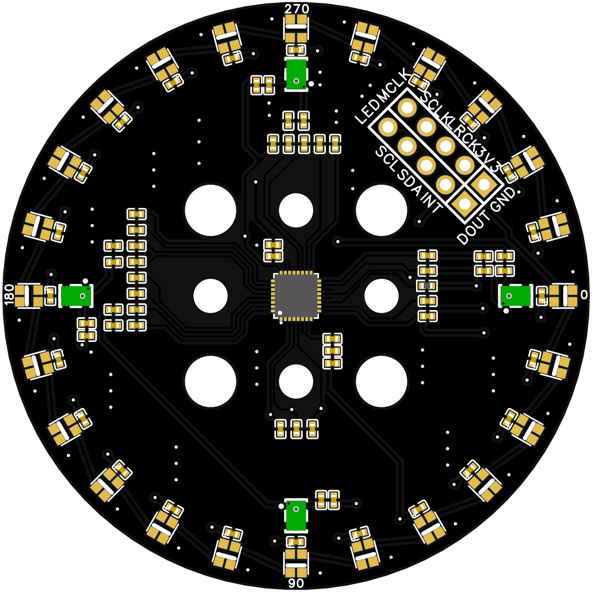

# SoundCompass — Arduino Library for Four-Mic Sound Source Localization

**English** | [简体中文](README.zh-CN.md)

An Arduino-style library that turns the SoundCompass four-microphone ring into a direction finder:
it captures four ES7210 channels over I2S TDM, estimates the sound source angle with GCC-PHAT, and
drives the 24 on-board RGB LEDs towards the source.



**Requires ESP32 Arduino core 3.2.0.** The localization core is shipped as a precompiled static
library, so `esp-sr` does not have to be installed in the Arduino IDE.

- [Features](#features)
- [Hardware](#hardware)
- [Requirements](#requirements)
- [Installation](#installation)
- [Wiring](#wiring)
- [Quick start](#quick-start)
- [Examples](#examples)
- [API](#api)
- [How the precompiled core works](#how-the-precompiled-core-works)
- [Rebuilding libsl_core.a](#rebuilding-libsl_corea)
- [Notes and limitations](#notes-and-limitations)
- [Troubleshooting](#troubleshooting)
- [License](#license)

## Features

- **`MicArray`** — ES7210 setup over I2C plus 48 kHz / 4-channel I2S TDM capture.
- **`SoundLocalizer`** — background task that outputs angle, LED index, confidence and levels;
  polling or callback style.
- **`LedRing`** — RMT-driven WS2812 effects: point, trail, breath, comet, with rainbow or solid color.
- **Voice-only mode** — WebRTC VAD from `esp-sr`, compiled into the library; no model partition.
- **No extra dependencies** — everything needed is inside this library.

## Hardware

The module is the analog and optical front end; an ESP32 board runs the sketch.

| Item | Detail |
| --- | --- |
| ADC | ES7210, 4 channels, I2C address `0x40` (scanned `0x40`–`0x43`) |
| Microphones | 4 × MEMS, 40 mm diagonal spacing, at 0°/90°/180°/270° |
| LEDs | 24 × addressable RGB (WS2812-compatible, GRB order), first LED at 0° |
| Interface | 2×5, 2.54 mm header: I2S, I2C, LED data, 3.3 V and GND |
| Board | Circular PCB marked `0`, `90`, `180`, `270` |

Buy the module on Taobao: <https://item.taobao.com/item.htm?id=1100133001269>

### Module pinout

Silkscreen labels, arranged as two rows of five:

| | 1 | 2 | 3 | 4 | 5 |
| --- | --- | --- | --- | --- | --- |
| **Upper row** | MCLK | SCLK | LRCK | 3V3 | GND |
| **Lower row** | LED | SCL | SDA | INT | DOUT |

| Signal | Direction | Function | Default GPIO (ESP32-S3) |
| --- | --- | --- | --- |
| `MCLK` | ESP32 → module | I2S master clock, 18.432 MHz (384 × fs) | 16 |
| `SCLK` | ESP32 → module | I2S bit clock, 6.144 MHz | 17 |
| `LRCK` | ESP32 → module | I2S word clock / WS, 48 kHz | 18 |
| `DOUT` | module → ESP32 | I2S data from the ES7210 | 15 |
| `SCL` | ESP32 → module | I2C clock | 5 |
| `SDA` | ESP32 ↔ module | I2C data | 6 |
| `INT` | module → ESP32 | ES7210 interrupt — unused | — |
| `LED` | ESP32 → module | WS2812 data | 4 |
| `3V3` | power | 3.3 V supply | 3V3 |
| `GND` | power | Ground | GND |

The ESP32 is the I2S master and generates `MCLK`, `SCLK` and `LRCK`; the ES7210 sends all four
microphone channels on `DOUT`.

### Microphone and LED layout

```
                MIC2 (270°)
                     |
    MIC4 (180°) -----+----- MIC1 (0°)
                     |
                MIC3 (90°)
```

MIC1–MIC4 are 40 mm apart; MIC2–MIC3 are 40 mm apart. LED 1 is at 0° and the 24 LEDs are spaced
15° apart.

## Requirements

- **ESP32 Arduino core 3.2.0** — required. The precompiled core was built with the ESP-IDF 5.5.4
  toolchain and link-tested with `esp32:esp32` 3.2.0 on ESP32-S3. Arduino core 2.x is based on
  ESP-IDF 4.4 and has neither `i2s_tdm` nor `i2c_master`, so it will not compile.
- Arduino IDE 1.8+/2.x, `arduino-cli`, or PlatformIO.

Supported targets, selected by the board's `build.mcu`:

| Chip | `build.mcu` | Arduino board (core 3.2.0) | Status |
| --- | --- | --- | --- |
| ESP32-S3 | `esp32s3` | ESP32S3 Dev Module | Supported, tested |
| ESP32-C3 | `esp32c3` | ESP32C3 Dev Module | Supported |
| ESP32-C6 | `esp32c6` | ESP32C6 Dev Module | Supported |
| ESP32-P4 | `esp32p4` | ESP32P4 Dev Module | Supported |
| ESP32-C5 | `esp32c5` | no board in 3.2.0 yet | Library provided |
| ESP32 / S2 / C2 | — | — | No I2S TDM |
| ESP32-H2 | — | — | No `esp-sr` VAD library |

> The default pins target ESP32-S3. Remap them for other chips — the ESP32-C3, for example, has no
> GPIO15–17.

## Installation

**Arduino IDE** — download or clone this repository, then either:

- `Sketch → Include Library → Add .ZIP Library…` and pick a zip of this folder, or
- copy the folder into your Arduino libraries directory and rename it to `SoundCompass`
  (`Documents/Arduino/libraries/SoundCompass` on Windows, `~/Arduino/libraries/SoundCompass` on
  Linux/macOS).

**arduino-cli**

```bash
arduino-cli lib install --git-url <repository-url>
```

**PlatformIO** — copy this folder into `lib/`, or add it to `lib_deps`. Use a platform that provides
Arduino-ESP32 3.2.0.

## Wiring

Defaults are compiled into `MicArray::Config` and `LedRing::Config` and can be changed per instance:

| Module pin | ESP32-S3 GPIO |
| --- | --- |
| `SCL` | 5 |
| `SDA` | 6 |
| `MCLK` | 16 |
| `SCLK` | 17 |
| `LRCK` | 18 |
| `DOUT` | 15 |
| `LED` | 4 |
| `3V3` | 3V3 |
| `GND` | GND |
| `INT` | not connected |

Also connect the grounds of the ESP32 board and the module before powering up.

## Quick start

```cpp
#include <SoundCompass.h>

MicArray mic;
SoundLocalizer locator;

void setup() {
    Serial.begin(115200);

    if (!mic.begin()) {
        Serial.println("mic init failed");
        return;
    }

    SoundLocalizer::Config cfg;
    cfg.micSpacingM = 0.040f;
    cfg.clockwise = false;
    cfg.minConfidence = 0.15f;
    cfg.voiceMinDb = -52.0f;
    if (!locator.begin(mic, cfg)) {
        Serial.println("localizer init failed");
        return;
    }
}

void loop() {
    SoundLocalizer::Result r;
    if (locator.getResult(r)) {
        Serial.printf("angle=%.1f led=%d conf=%.2f\n", r.angleDeg, r.ledIndex, r.confidence);
    }
    delay(100);
}
```

To drive the ring from the localization callback, see `examples/RingFollow`:

```cpp
LedRing ring;
ring.begin();
locator.begin(mic, cfg, [](const SoundLocalizer::Result &r, void *) {
    ring.setTarget(r.ledIndex, 1.0f);
});
```

## Examples

| Sketch | Content |
| --- | --- |
| `BasicAngle` | Localization only; prints angle, LED index, confidence and levels |
| `RingFollow` | Localization callback drives the LED ring |
| `FullDemo` | Mirrors the ESP-IDF demo: serial keys switch LED effects and localization modes |

`FullDemo` serial keys at 115200 baud:

| Key | LED effect | Key | Localization mode |
| --- | --- | --- | --- |
| `1` | `POINT` | `q` | `TRACK` |
| `2` | `TRAIL` | `w` | `PEAK` |
| `3` | `BREATH` | `e` | `VOICE` |
| `4` | `COMET` | `r` | `OFF` |
| `5` | `OFF` | | |

## API

### MicArray

| Method | Description |
| --- | --- |
| `begin()` / `begin(cfg)` | Create I2C, probe and configure the ES7210, start I2S TDM |
| `end()` | Release I2S and I2C |
| `read(dst, frames, timeoutMs)` | Blocking read of `frames` frames, 4-channel interleaved `int16` |
| `isReady()` | `true` once capture is running |
| `sampleRate()` / `channels()` | `48000` / `4` |

`MicArray::Config` defaults: `i2sPort = 0`, `sclGpio = 5`, `sdaGpio = 6`, `mclkGpio = 16`,
`bclkGpio = 17`, `wsGpio = 18`, `dinGpio = 15`, `sampleRate = 48000`, `gainDb = 30` (0–42 dB in
3 dB steps).

### SoundLocalizer

| Method | Description |
| --- | --- |
| `begin(mic[, cfg[, cb, user]])` | Initialize the core and start the background task |
| `start(cb, user)` / `stop()` | Start or pause the background task |
| `setMode(Mode)` / `getMode()` | `TRACK`, `PEAK`, `VOICE` or `OFF` |
| `getResult(Result&)` | Read the latest result; `false` if there is none yet |
| `getAngle()` | Angle in degrees, or `NAN` |
| `getLedIndex()` | LED index, or `-1` |

`SoundLocalizer::Config` defaults: `sampleRate = 48000`, `micSpacingM = 0.04`,
`angleOffsetDeg = 0`, `clockwise = true`, `micMap = {0,1,2,3}`, `frameLength = 2048`,
`ledCount = 24`, `voiceMinDb = -40`, `minConfidence = 0.35`, `mode = TRACK`.

`Result` contains `angleDeg`, `ledIndex`, `confidence`, `levelDb[4]`, `maxLevelDb` and `isVoice`.
`micMap` remaps logical MIC1–MIC4 onto different physical channels when the wiring differs from the
silkscreen.

| Mode | Behavior |
| --- | --- |
| `TRACK` | Update every frame |
| `PEAK` | Update only on energy peaks |
| `VOICE` | Only human voice triggers an update (requires 48 kHz capture) |
| `OFF` | Pause processing |

### LedRing

| Method | Description |
| --- | --- |
| `begin()` / `begin(cfg)` | Create the RMT channel and start the refresh task |
| `end()` | Stop the task and release RMT |
| `setTarget(ledIndex, intensity)` | Light one LED, `intensity` 0–1 |
| `setMode(Mode)` / `getMode()` | `POINT`, `TRAIL`, `BREATH`, `COMET` or `OFF` |
| `setColorMode(ColorMode)` / `getColorMode()` | `RAINBOW` or `SOLID` |
| `setColor(r, g, b)` | Set the solid color and switch to `SOLID` |
| `clear()` | Turn all LEDs off |

`LedRing::Config` defaults: `pin = 4`, `ledCount = 24` (max 64), `mode = TRAIL`,
`colorMode = RAINBOW`, `r/g/b = 0/0/255`, `maxBrightness = 255`, `grbOrder = true`,
`trailLength = 6`, `decayMs = 450`, `idleTimeoutMs = 1200`, `refreshMs = 25`.

## How the precompiled core works

Each `src/<chip>/libsl_core.a` contains:

1. The `sl_core.c` objects — DC removal, pre-emphasis, Hann window, FFT, GCC-PHAT delay, angle
   conversion, circular smoothing and the two-frame peak decision.
2. The VAD objects extracted from that chip's `esp-sr` `libesp_audio_processor.a`, together with
   their transitive dependencies (`vad_create_with_param`, `vad_process`, `vad_destroy`).

So a sketch links a single archive and never references `esp-sr`.

Arduino finds the archive as follows:

- The folder name must be `src/{build.mcu}`: `src/esp32s3/`, `src/esp32c6/`, and so on. An archive
  in the wrong folder is ignored.
- `library.properties` declares:

  ```
  precompiled=true
  ldflags=-lsl_core
  ```

  `precompiled=true` marks a mixed library (sources are still compiled) and `ldflags` adds the
  archive to the link line.
- Only the folder matching the selected board is linked, so one library can carry all targets.

## Rebuilding libsl_core.a

The core is rebuilt with the ESP-IDF toolchain, not with Arduino:

```powershell
powershell -ExecutionPolicy Bypass -File extras\precompiled\build_lib.ps1
```

Options:

- `-Targets` — comma-separated, default `esp32s3,esp32c3,esp32c5,esp32c6,esp32p4`
- `-XtensaBin` — Xtensa toolchain `bin` directory
- `-RiscvBin` — RISC-V toolchain `bin` directory
- `-EspSrDir` — `esp-sr` component directory (defaults to the repository's `managed_components`)

The script compiles `extras/precompiled/sl_core.c` for each target and uses `ld -r` to pull in the
required VAD objects from the matching `esp-sr` archive, so the member list never has to be
maintained by hand.

If your Arduino core uses a different IDF 5.x toolchain, rebuild the archive with that toolchain to
avoid ABI differences.

## Notes and limitations

- Archives are provided for ESP32-S3, C3, C5, C6 and P4. ESP32/S2/C2 have no I2S TDM and ESP32-H2
  has no `esp-sr` precompiled VAD library.
- On non-S3 chips the Arduino core must contain `tools/esp32-arduino-libs/<idf>/<chip>/`. Minimal
  installs sometimes ship only the S3 toolchain and then fail at the bootloader step.
- The VAD is fixed at 16 kHz. At 48 kHz the library decimates 3:1; at other sample rates `isVoice`
  stays `false` and `VOICE` mode never triggers.
- The library uses the ESP-IDF `i2c_master`, `i2s_tdm` and RMT drivers. Do not also use `Wire` or
  the Arduino `I2S` class on the same peripherals.
- Localization and LED refresh each own a background task (priority 5 and 4). Keep callbacks short.
- Do not link `esp-sr` manually as well: the `vad_*` symbols would be defined twice.
- `LedRing` supports up to 64 LEDs.

## Troubleshooting

**`mic init failed`** — check `SCL`/`SDA`, the 3.3 V supply and the grounds. The ES7210 answers at
`0x40`–`0x43`.

**Angle is mirrored** — set `cfg.clockwise = false` (the examples already do this for the shipped
module). For a constant offset, use `cfg.angleOffsetDeg`.

**Wrong channel order** — adjust `cfg.micMap`.

**LEDs dark or wrong colors** — check the `LED` wire on GPIO4; if red and green are swapped, set
`grbOrder` in `LedRing::Config`.

**Unstable angle** — raise `minConfidence`, switch to `SoundLocalizer::PEAK`, or lower `gainDb`
from 30 to 24 if the microphones clip.

**Linker errors about `vad_*`** — remove `esp-sr` from the project; this library already contains it.

## License

Released under the [MIT License](LICENSE). The VAD objects inside `libsl_core.a` come from
[Espressif `esp-sr`](https://github.com/espressif/esp-sr) (Apache-2.0) and are repackaged without
source changes; that license still applies to them.

The ESP-IDF version of this project lives in a separate repository.
