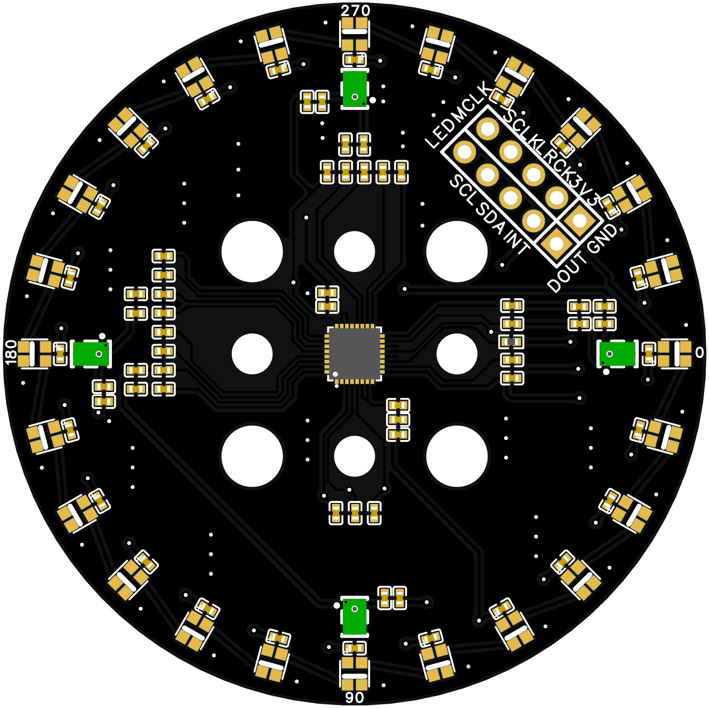

# SoundCompass — 四麦声源定位 Arduino 库

[English](README.md) | **简体中文**

把 SoundCompass 四麦环形模块封装成 Arduino 风格的库：通过 I2S TDM 采集 ES7210 的四路信号，
用 GCC-PHAT 估计声源角度，并驱动板上的 24 颗 RGB 灯指向声源。

<p align="center"></p>

**需要 ESP32 Arduino 核心库 3.2.0。** 定位核心以预编译静态库形式提供，Arduino IDE 里
不需要安装 `esp-sr`。

- [功能特点](#功能特点)
- [硬件](#硬件)
- [环境要求](#环境要求)
- [安装](#安装)
- [接线](#接线)
- [快速开始](#快速开始)
- [示例](#示例)
- [API](#api)
- [预编译核心说明](#预编译核心说明)
- [重建 libsl_core.a](#重建-libsl_corea)
- [说明与限制](#说明与限制)
- [常见问题](#常见问题)
- [许可证](#许可证)

## 功能特点

- **`MicArray`** — I2C 配置 ES7210，48 kHz、4 通道 I2S TDM 采集。
- **`SoundLocalizer`** — 后台任务输出角度、灯珠序号、置信度和电平，支持轮询或回调。
- **`LedRing`** — RMT 驱动 WS2812：单点、拖尾、呼吸、彗星，支持彩虹或单色。
- **仅人声模式** — 集成 `esp-sr` 的 WebRTC VAD，不需要 model 分区。
- **无额外依赖** — 所需内容全部包含在本库内。

## 硬件

模块负责模拟采集和灯环显示，实际程序跑在 ESP32 开发板上。

| 项目 | 说明 |
| --- | --- |
| ADC | ES7210，4 通道，I2C 地址 `0x40`（扫描范围 `0x40`–`0x43`） |
| 麦克风 | 4 颗 MEMS，对角间距 40 mm，位于 0°/90°/180°/270° |
| 灯珠 | 24 颗可寻址 RGB（兼容 WS2812，GRB 顺序），第 1 颗在 0° |
| 接口 | 2×5、2.54 mm 排针：I2S、I2C、灯珠数据、3.3 V 与 GND |
| 板型 | 圆形 PCB，板边丝印 `0`、`90`、`180`、`270` |

购买链接（淘宝）：<https://item.taobao.com/item.htm?id=1100133001269>

### 模块引脚

按丝印标注，排针为两排五列：

| | 1 | 2 | 3 | 4 | 5 |
| --- | --- | --- | --- | --- | --- |
| **上排** | MCLK | SCLK | LRCK | 3V3 | GND |
| **下排** | LED | SCL | SDA | INT | DOUT |

| 信号 | 方向 | 作用 | 默认 GPIO（ESP32-S3） |
| --- | --- | --- | --- |
| `MCLK` | ESP32 → 模块 | I2S 主时钟，18.432 MHz（384 × fs） | 16 |
| `SCLK` | ESP32 → 模块 | I2S 位时钟，6.144 MHz | 17 |
| `LRCK` | ESP32 → 模块 | I2S 帧时钟 / WS，48 kHz | 18 |
| `DOUT` | 模块 → ESP32 | ES7210 的 I2S 数据 | 15 |
| `SCL` | ESP32 → 模块 | I2C 时钟 | 5 |
| `SDA` | ESP32 ↔ 模块 | I2C 数据 | 6 |
| `INT` | 模块 → ESP32 | ES7210 中断 — 未使用 | — |
| `LED` | ESP32 → 模块 | WS2812 数据 | 4 |
| `3V3` | 电源 | 3.3 V 供电 | 3V3 |
| `GND` | 电源 | 地 | GND |

ESP32 是 I2S 主机，产生 `MCLK`、`SCLK` 和 `LRCK`；ES7210 通过 `DOUT` 输出四路麦克风数据。

### 麦克风与灯珠布局

```
                MIC2 (270°)
                     |
    MIC4 (180°) -----+----- MIC1 (0°)
                     |
                MIC3 (90°)
```

MIC1–MIC4 间距 40 mm，MIC2–MIC3 间距 40 mm。第 1 颗灯在 0°，24 颗灯每颗间隔 15°。

## 环境要求

- **ESP32 Arduino 核心库 3.2.0** — 必需。预编译核心使用 ESP-IDF 5.5.4 工具链构建，并在
  ESP32-S3 上以 `esp32:esp32` 3.2.0 完成链接验证。Arduino 2.x 基于 ESP-IDF 4.4，
  没有 `i2s_tdm` 和 `i2c_master`，无法编译。
- Arduino IDE 1.8+/2.x、`arduino-cli` 或 PlatformIO。

支持目标（按开发板的 `build.mcu` 选择）：

| 芯片 | `build.mcu` | 3.2.0 中的开发板 | 状态 |
| --- | --- | --- | --- |
| ESP32-S3 | `esp32s3` | ESP32S3 Dev Module | 支持，已验证 |
| ESP32-C3 | `esp32c3` | ESP32C3 Dev Module | 支持 |
| ESP32-C6 | `esp32c6` | ESP32C6 Dev Module | 支持 |
| ESP32-P4 | `esp32p4` | ESP32P4 Dev Module | 支持 |
| ESP32-C5 | `esp32c5` | 3.2.0 暂无开发板 | 已提供库 |
| ESP32 / S2 / C2 | — | — | 无 I2S TDM |
| ESP32-H2 | — | — | `esp-sr` 无 VAD 库 |

> 默认引脚面向 ESP32-S3。换其他芯片需要重新映射，例如 ESP32-C3 没有 GPIO15–17。

## 安装

**Arduino IDE** — 下载或克隆本仓库后，任选一种：

- `项目 → 加载库 → 添加 .ZIP 库…`，选择本目录打包出的 zip；或
- 把目录复制到 Arduino 库目录，并重命名为 `SoundCompass`
  （Windows 为 `Documents/Arduino/libraries/SoundCompass`，Linux/macOS 为
  `~/Arduino/libraries/SoundCompass`）。

**arduino-cli**

```bash
arduino-cli lib install --git-url <repository-url>
```

**PlatformIO** — 把本目录复制到工程的 `lib/`，或加入 `lib_deps`，并使用提供
Arduino-ESP32 3.2.0 的平台。

## 接线

默认值写在 `MicArray::Config` 与 `LedRing::Config` 中，可逐个实例修改：

| 模块引脚 | ESP32-S3 GPIO |
| --- | --- |
| `SCL` | 5 |
| `SDA` | 6 |
| `MCLK` | 16 |
| `SCLK` | 17 |
| `LRCK` | 18 |
| `DOUT` | 15 |
| `LED` | 4 |
| `3V3` | 3V3 |
| `GND` | GND |
| `INT` | 不接 |

上电前请先把 ESP32 开发板与模块共地。

## 快速开始

```cpp
#include <SoundCompass.h>

MicArray mic;
SoundLocalizer locator;

void setup() {
    Serial.begin(115200);

    if (!mic.begin()) {
        Serial.println("mic init failed");
        return;
    }

    SoundLocalizer::Config cfg;
    cfg.micSpacingM = 0.040f;
    cfg.clockwise = false;
    cfg.minConfidence = 0.15f;
    cfg.voiceMinDb = -52.0f;
    if (!locator.begin(mic, cfg)) {
        Serial.println("localizer init failed");
        return;
    }
}

void loop() {
    SoundLocalizer::Result r;
    if (locator.getResult(r)) {
        Serial.printf("angle=%.1f led=%d conf=%.2f\n", r.angleDeg, r.ledIndex, r.confidence);
    }
    delay(100);
}
```

在定位回调里驱动灯环，可参考 `examples/RingFollow`：

```cpp
LedRing ring;
ring.begin();
locator.begin(mic, cfg, [](const SoundLocalizer::Result &r, void *) {
    ring.setTarget(r.ledIndex, 1.0f);
});
```

## 示例

| 示例 | 内容 |
| --- | --- |
| `BasicAngle` | 只做定位，串口打印角度、灯珠序号、置信度和电平 |
| `RingFollow` | 在定位回调里驱动灯环 |
| `FullDemo` | 对齐 ESP-IDF 示例：串口按键切换灯效与定位模式 |

`FullDemo` 串口按键（115200）：

| 按键 | 灯效 | 按键 | 定位模式 |
| --- | --- | --- | --- |
| `1` | `POINT` | `q` | `TRACK` |
| `2` | `TRAIL` | `w` | `PEAK` |
| `3` | `BREATH` | `e` | `VOICE` |
| `4` | `COMET` | `r` | `OFF` |
| `5` | `OFF` | | |

## API

### MicArray

| 方法 | 说明 |
| --- | --- |
| `begin()` / `begin(cfg)` | 建 I2C、探测并配置 ES7210、启动 I2S TDM |
| `end()` | 释放 I2S 和 I2C |
| `read(dst, frames, timeoutMs)` | 阻塞读取 `frames` 帧，4 通道交错 `int16` |
| `isReady()` | 采集就绪后返回 `true` |
| `sampleRate()` / `channels()` | `48000` / `4` |

`MicArray::Config` 默认值：`i2sPort = 0`、`sclGpio = 5`、`sdaGpio = 6`、`mclkGpio = 16`、
`bclkGpio = 17`、`wsGpio = 18`、`dinGpio = 15`、`sampleRate = 48000`、
`gainDb = 30`（0–42 dB，3 dB 步进）。

### SoundLocalizer

| 方法 | 说明 |
| --- | --- |
| `begin(mic[, cfg[, cb, user]])` | 初始化核心并启动后台任务 |
| `start(cb, user)` / `stop()` | 启动或暂停后台任务 |
| `setMode(Mode)` / `getMode()` | `TRACK`、`PEAK`、`VOICE` 或 `OFF` |
| `getResult(Result&)` | 读取最近一次结果，尚无结果时返回 `false` |
| `getAngle()` | 角度，无结果为 `NAN` |
| `getLedIndex()` | 灯珠序号，无结果为 `-1` |

`SoundLocalizer::Config` 默认值：`sampleRate = 48000`、`micSpacingM = 0.04`、
`angleOffsetDeg = 0`、`clockwise = true`、`micMap = {0,1,2,3}`、`frameLength = 2048`、
`ledCount = 24`、`voiceMinDb = -40`、`minConfidence = 0.35`、`mode = TRACK`。

`Result` 包含 `angleDeg`、`ledIndex`、`confidence`、`levelDb[4]`、`maxLevelDb` 和
`isVoice`。接线与丝印不一致时，用 `micMap` 把逻辑 MIC1–MIC4 映射到实际物理通道。

| 模式 | 行为 |
| --- | --- |
| `TRACK` | 每帧更新 |
| `PEAK` | 仅在能量峰值帧更新 |
| `VOICE` | 仅人声触发（要求 48 kHz 采集） |
| `OFF` | 暂停处理 |

### LedRing

| 方法 | 说明 |
| --- | --- |
| `begin()` / `begin(cfg)` | 建 RMT 通道并启动刷新任务 |
| `end()` | 停止任务并释放 RMT |
| `setTarget(ledIndex, intensity)` | 点亮某颗灯，`intensity` 0–1 |
| `setMode(Mode)` / `getMode()` | `POINT`、`TRAIL`、`BREATH`、`COMET` 或 `OFF` |
| `setColorMode(ColorMode)` / `getColorMode()` | `RAINBOW` 或 `SOLID` |
| `setColor(r, g, b)` | 设置单色并切到 `SOLID` |
| `clear()` | 全部熄灭 |

`LedRing::Config` 默认值：`pin = 4`、`ledCount = 24`（最大 64）、`mode = TRAIL`、
`colorMode = RAINBOW`、`r/g/b = 0/0/255`、`maxBrightness = 255`、`grbOrder = true`、
`trailLength = 6`、`decayMs = 450`、`idleTimeoutMs = 1200`、`refreshMs = 25`。

## 预编译核心说明

每份 `src/<芯片>/libsl_core.a` 包含：

1. `sl_core.c` 编译出的对象：去直流、预加重、汉宁窗、FFT、GCC-PHAT 时延、角度换算、
   圆周平滑和两帧峰值判定。
2. 从该芯片 `esp-sr` 的 `libesp_audio_processor.a` 中抽取的 VAD 目标文件及其传递依赖
   （`vad_create_with_param`、`vad_process`、`vad_destroy`）。

因此 Arduino 工程只需链接一个 `.a`，不会引用 `esp-sr`。

Arduino 查找该库的规则：

- 目录名必须是 `src/{build.mcu}`，例如 `src/esp32s3/`、`src/esp32c6/`，放错目录不会被链接。
- `library.properties` 中声明：

  ```
  precompiled=true
  ldflags=-lsl_core
  ```

  `precompiled=true` 表示混合库（源码照常编译），`ldflags` 把 `.a` 加入链接命令。
- 只会链接当前开发板对应的目录，所以一个库可以同时携带多个芯片的预编译文件。

## 重建 libsl_core.a

核心使用 ESP-IDF 工具链重建，而不是 Arduino：

```powershell
powershell -ExecutionPolicy Bypass -File extras\precompiled\build_lib.ps1
```

参数：

- `-Targets` — 逗号分隔，默认 `esp32s3,esp32c3,esp32c5,esp32c6,esp32p4`
- `-XtensaBin` — Xtensa 工具链 `bin` 目录
- `-RiscvBin` — RISC-V 工具链 `bin` 目录
- `-EspSrDir` — `esp-sr` 组件目录（默认取仓库的 `managed_components`）

脚本为每个目标编译 `extras/precompiled/sl_core.c`，再用 `ld -r` 从对应的 `esp-sr` 归档中
自动收敛所需的 VAD 目标文件，不需要手工维护成员列表。

如果 Arduino 核心库使用的是其他 IDF 5.x 工具链，建议用该工具链重新编译一次，避免 ABI 差异。

## 说明与限制

- 已提供 ESP32-S3、C3、C5、C6、P4 的 `.a`。ESP32/S2/C2 没有 I2S TDM，ESP32-H2 没有
  `esp-sr` 预编译 VAD 库。
- 非 S3 芯片要求 Arduino 核心目录中存在 `tools/esp32-arduino-libs/<idf>/<芯片>/`。
  精简版安装有时只保留 S3 工具链，会在生成 bootloader 阶段失败。
- VAD 固定 16 kHz。48 kHz 时库内做 3:1 抽取；其他采样率下 `isVoice` 恒为 `false`，
  `VOICE` 模式不会触发。
- 本库使用 ESP-IDF 的 `i2c_master`、`i2s_tdm` 和 RMT 驱动，请不要再同时用 `Wire` 或
  Arduino `I2S` 类操作同一组外设。
- 定位与灯效各自有后台任务（优先级 5 和 4），回调中不要做阻塞操作。
- 不要再手动链接 `esp-sr`，否则 `vad_*` 符号会重复定义。
- `LedRing` 最多支持 64 颗灯。

## 常见问题

**`mic init failed`** — 检查 `SCL`/`SDA`、3.3 V 供电和共地。ES7210 会应答 `0x40`–`0x43`。

**角度方向反了** — 设置 `cfg.clockwise = false`（示例中已针对出货模块这样设置）。固定角度
偏差用 `cfg.angleOffsetDeg` 补偿。

**通道顺序不对** — 调整 `cfg.micMap`。

**灯不亮或颜色不对** — 检查 GPIO4 的 `LED` 数据线；红绿互换时设置 `LedRing::Config`
中的 `grbOrder`。

**角度不稳定** — 调高 `minConfidence`，改用 `SoundLocalizer::PEAK`；麦克风削顶时把
`gainDb` 从 30 降到 24。

**出现 `vad_*` 链接错误** — 从工程中移除 `esp-sr`，本库已经包含它。

## 许可证

采用 [MIT License](LICENSE)。`libsl_core.a` 中的 VAD 目标文件来自
[Espressif `esp-sr`](https://github.com/espressif/esp-sr)（Apache-2.0），仅做目标文件重打包，
未修改源码，仍适用其原有许可。

本工程的 ESP-IDF 版本位于另一个独立仓库。
